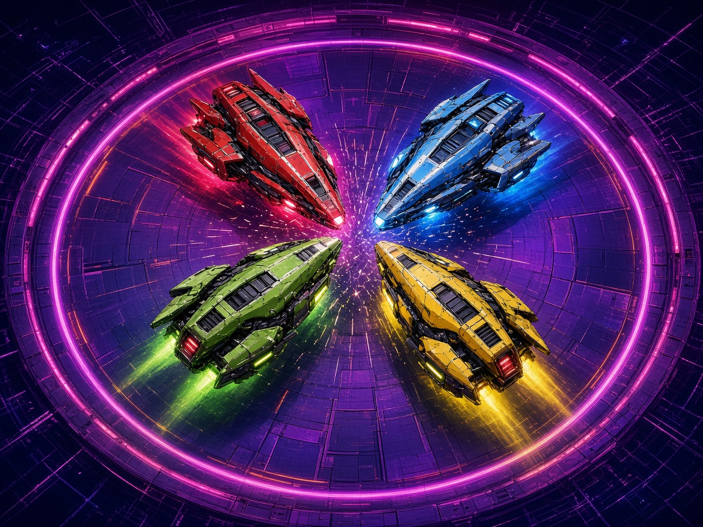

# Hover Derby 4

Four hovercraft share one shrinking neon ring. Bump your rivals over the edge, because the last craft still inside takes the round. First to 3 rounds takes the match.

It is a local free-for-all for one screen. Play with up to four people on one keyboard, plug in gamepads, or fill the empty seats with bots and ride solo. Physics, scoring, and the randomizer are plain JavaScript modules with no build step and no network.

## Launch

The game is a static page. A tiny Python server hosts it on `127.0.0.1` so the modules load, then opens your browser. The preferred port is **8802** (from `arcade.json`). If that port is taken, the server uses the next free one.

| System | One-click launcher |
| --- | --- |
| macOS | Double-click `launch-mac.command` |
| Windows | Double-click `launch-windows.bat` |
| Linux | `./launch-linux.sh` |

From a terminal, in this folder:

```bash
python3 server.py
```

Add `--no-browser` to serve without opening a window, or `--port 9000` to ask for a different port. If Python 3 is missing, the launcher says so instead of failing silently. Install it from [python.org](https://www.python.org/downloads/).

Everything after that stays on your machine. Audio is synthesized in the browser. There is no account and no install.

## Controls

Keyboard bindings are physical keys (`KeyboardEvent.code`) and can be remapped in Settings. The new map is saved in `localStorage`.

| Rider | Move | Boost | Pulse |
| --- | --- | --- | --- |
| P1 RUSH | W A S D | F | G |
| P2 AERO | Arrow keys | / | . |
| P3 JADE | I J K L | ; | ' |
| P4 SOLAR | Numpad 8 4 5 6 | Numpad 0 | Numpad Enter |
| Gamepad | Left stick or D-pad | A | B |

- **Start** (gamepad) or **Enter** confirms menus. **Esc** or **Start** pauses.
- **M** mutes. Volume and “first to N” live in Settings.
- On the join screen, a rider’s **boost** key joins as a human. **Pulse** cycles that seat through human, bot, and off.
- A connected gamepad claims seats 0–3 for P1–P4 and overrides that rider’s keyboard until it is unplugged. Hot-plug works mid-match. A pad icon shows on the HUD.

## Rules

- Every craft has real momentum. Steering adds thrust; letting go leaves you sliding.
- Crafts bounce with elastic circle collisions. A heavier craft (the Heavy pickup) shoves harder.
- **Boost** is a dash along your stick, or along your nose if the stick is idle. It has a cooldown, drawn under each score.
- **Pulse** is a short shockwave that knocks nearby craft away. It has its own cooldown.
- The ring shrinks. When it gets tight, it collapses faster. Leave the ring and you are eliminated. A Shield pickup throws you back inside instead.
- Nitro refills boost and raises acceleration for a few seconds.
- Last craft in the ring wins the round. If the last two exit on the same tick, the one closer to the center wins.
- Default match is first to 3. Settings also offers first to 1, 5, or 7. That choice applies to the next match.
- Empty seats can be bots, so one human can start against the pack. A match needs at least two racers.

## Scoring

Each round win adds one point, shown on that rider’s chip. The match ends as soon as someone reaches the target. The results screen lists the standings and offers a rematch with the same seats.

## arcade.json

`arcade.json` is the Arcade OS manifest: display name, id `hoverderby4`, cover and icon paths, per-platform launch commands, 4 players (minimum 1), keyboard and gamepad input, version `1.0.0`, and port `8802`. `server.py` reads that port when it starts.

## Tests

Core rules run under Node’s built-in test runner. There are no packages to install.

```bash
node --test tests/
python3 tests/server_smoke.py
```

The Node tests cover movement and collisions, elimination, round and match wins, boost, pulse, and pickups, seeded RNG determinism, keyboard and gamepad mapping, bot recovery, and the manifest. The Python smoke test starts `server.py` without a browser and checks that `index.html`, the modules, the manifest, and the cover all come back. GitHub Actions runs both on push and pull request.

## License

[MIT](LICENSE).
